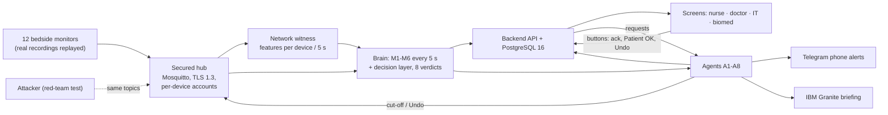

# [TessNova_IBM Z Datathon 2026 Project] SentinelWard

Team TessNova · IBM Z Datathon 2026 · Theme 1: real-time AI decisions on IBM LinuxONE.

> An ICU alarm goes off. Is it the patient, a failing sensor, or someone faking the monitor?
> SentinelWard answers for every bed, every 5 seconds, on IBM LinuxONE, and never shows a patient blank.

[Architecture](docs/ARCHITECTURE.md) · [Evidence pack](docs/evidence/INDEX.md) · [Video script](docs/VIDEO-SCRIPT.md) · [Open source used](docs/OPEN-SOURCE.md)

## The problem
- ICU monitors raise so many false alarms that nurses learn to tune them out (alarm fatigue).
- The same monitors stream vital signs over the hospital network, where data can be replayed, forged or flooded.
- A sensor that fails or slowly drifts looks, on screen, much like a patient getting worse.
- So a central-station nurse cannot tell a real emergency from a faked or failing signal in time.

## What SentinelWard does
Bedside monitors send one reading per bed per second into a secured message hub. Every 5 seconds, six checks score every bed, a decision layer turns the six scores into one of eight verdicts with plain-word reasons, and eight agents act on that verdict (`docs/spec/00-contract-v1.2.md`, `brain/README.md`).

| Check | Question it answers |
|---|---|
| M1 | Is the sensor unusable (flat, clipped, noisy, missing)? |
| M2 | Is this monitor alarm real? (gradient-boosted trees trained on LinuxONE) |
| M3 | Do heartbeat and pulse still agree for this patient? |
| M4 | Is this a replay of the bed's own earlier data? |
| M5 | Does the device's network traffic look like an attack (flood, sequence repeats, second sender)? |
| M6 | Is the arterial line drifting away from this patient's own cuff readings? |
| D | Decision layer: one verdict, trust, up to 3 reasons, fixed precedence |

Verdicts, highest precedence first (`brain/README.md`): **BOTH** (real emergency during an attack) · **EMERGENCY** · **TAMPERING** · **DRIFTING** · **LOOSE_SENSOR** · **DEVICE_ATTACK** (IT only) · **UNSURE** (bedside hand-check) · **NORMAL**.

| Agent | Job (`agents_v2/REPORT.md`) |
|---|---|
| A1 | Alerts to screen and Telegram, one per bed episode, 30 s escalation ladder, ack |
| A2 | Marks the bed untrusted at once; cuts the device off at our own hub after 20 s of sustained evidence (at once on BOTH); Undo |
| A3 | Evidence: 10-minute ring buffer per bed, timeline with SHA-256 |
| A4 | Fleet hunt for other devices of the same kind |
| A5 | CERT-In report draft with its 6-hour clock (a person sends it; no send code exists) |
| A6 | Biomed tickets for drifting / repeatedly loose sensors |
| A7 | Nurse workload (alerts per nurse in 2 h) |
| A8 | Shift briefing written by IBM Granite on LinuxONE, every number fact-checked |

### Safety rules (enforced in code and tested)
- **Alarms are never suppressed.** The M2 score only explains an alarm; it never suppresses, delays or downgrades it (`brain/README.md`, tested in `brain/tests`).
- **Tampering never cancels an emergency.** A real alarm during an attack becomes BOTH: nurse alerted **and** device cut off (`docs/evidence/WARD-RUN.md`, B07).
- **Every automatic action has an Undo**, logged as a new action that `undoes` the original (`agents_v2/REPORT.md`, `docs/evidence/SECURITY.md`).
- **A cut-off never hides a real alarm.** The nurse is told to hand-check at once; the cut-off waits for 20 s of sustained evidence, or happens at once when an emergency is also present (`docs/evidence/SECURITY.md`).
- **The patient is never blank.** An untrusted or cut-off bed keeps showing its last trusted values (`docs/evidence/WARD-RUN.md`).
- SentinelWard only listens to monitors; it never sends anything back to one. Nothing automatic touches treatment.

## The data (all open, real recordings replayed)
| Dataset | Used for |
|---|---|
| PhysioNet/CinC Challenge 2015 (false arrhythmia alarms) | M2 training/testing (all 750 training records); ward beds B03, B04, B07 |
| VTaC (5,037 labelled ventricular-tachycardia alarms) | M2 training/testing |
| MIMIC-III Waveform Matched Subset (sample) | Quiet background beds (B01, B02, B05, B06, B11, B12) |
| VitalDB (surgery recordings with arterial line + cuff) | Drift / low-pressure beds (B08, B09, B10) |

Sources: `docs/evidence/ML-RESULTS.md`, `docs/OPEN-SOURCE.md`, `docs/spec/12-ward-script.md`. The simulator replays 12 real patient recordings at 125 Hz on a scripted 20-minute ward (`docs/spec/12-ward-script.md`). This is a lab ward, not a hospital deployment.

## IBM Z / LinuxONE
Everything that decides runs natively on s390x on one IBM LinuxONE guest: hub, six checks, decision layer, agents, backend, database, simulator, IBM Granite (`docs/evidence/PLATFORM.md`).

| Area | What we did | Evidence |
|---|---|---|
| Compute | IBM z17 (machine type 9175), CPU flag `nnpa` (Telum II on-chip AI), 3 vCPUs at 5,508 MHz, z/VM 7.3.0, Ubuntu 24.04 s390x | `docs/evidence/PLATFORM.md` |
| Telum II NNPA | A 1D-CNN ran on the z17 NNPA (`torch_nnpa 1.5.0`, `nnpa:0`): 670 held-out windows in 0.41 s, max NNPA−CPU difference 0.0018. It scored below the trees, so it is not deployed | `docs/evidence/ML-RESULTS.md` |
| AI trained on s390x | M2 trees trained on LinuxONE (scikit-learn 1.4.1), served as numpy-only trees, SHA-256 pinned | `docs/evidence/ML-RESULTS.md` |
| Containers | One s390x image built on LinuxONE; 6 containers (api, brain, sim, attacks, hub, db); non-root, read-only root, all capabilities dropped, no compiler in the image; two 20-minute ward runs inside: 11,790 messages each, 0 invalid | `docs/evidence/CONTAINERS.md` |
| Security | Mosquitto dynamic security, per-device accounts (each monitor may publish only its own bed), TLS 1.3 on 8883; live test 15/15 PASS; scrypt PINs, lockout, CSRF checks | `docs/evidence/SECURITY.md`, `security_v2/SECURITY.md` |
| Scale | One brain container (1.0 CPU) kept up with 96 beds: slowest tick 1.12 s of its 5 s budget (22.4%), 0 dropped | `docs/evidence/SCALE.md` |
| Resources | Whole live 12-bed ward: a few percent of 3 z17 cores (brain 2.2% CPU, 268 MiB) | `docs/evidence/RESOURCES.md` |
| IBM Granite | A8's shift briefing written by IBM Granite on LinuxONE in IBM's LinuxONE lab image; fact-checked, template fallback not needed in ward run 3 | `docs/evidence/WARD-RUN.md`, `agents_v2/REPORT.md` |

## Results (measured on LinuxONE, 17 Oct 2026)
**M2 "is this alarm real?"**: held-out sets locked before training (188 CinC records, 482 VTaC events); Challenge 2015 score = (TP+TN)/(TP+TN+FP+5·FN), 95% bootstrap CI (`docs/evidence/ML-RESULTS.md`).

| Model | CinC 2015 score | CinC AUROC | VTaC score | VTaC AUROC |
|---|---|---|---|---|
| Old live rule (baseline) | 0.391 [0.318, 0.484] | 0.677 | 0.336 [0.272, 0.412] | 0.505 |
| **M2 2-lead trees (live)** | **0.862 [0.785, 0.931]** | 0.968 | **0.832 [0.775, 0.885]** | 0.964 |
| 1D-CNN on z17 NNPA (not deployed) | 0.623 | 0.881 | 0.665 | 0.883 |

**Full 20-minute ward run, agents on** (run `run_20261017_141851`, 12 beds, scripted attacks; `docs/evidence/WARD-RUN.md`):

| Measure | Result |
|---|---|
| Ward-script checks | 12 of 13 PASS; B12 weak attack NOT SHOWN (cause found and fixed) |
| Event → verdict | +2 s to +3 s for every scripted event (B03, B04, B05, B06, B07, B08, B10, B11) |
| Time-to-safe (attack start → bed untrusted + nurse told + device cut off) | B06 4.3 s · B07 19.3 s · B05 24.2 s · B10 29.3 s |
| Real VTACH (B03) | EMERGENCY +2 s, ladder step 2 at 30 s, acked 05:48 |
| Real VFIB during an attack (B07) | BOTH 14:02: high alert never cancelled, cut off 14:03 |
| Replay attack (B05) | TAMPERING 10:02, cut off 10:23, IT Undo 15:29, NORMAL 17:02 |
| Quiet beds B01/B02 | 0 nurse alerts |
| Nurse alerts | 13 in 20 minutes for 12 beds |
| Telegram | 24 sent + 27 edited, 0 failed |
| Errors | 0 API errors, 0 agent errors; no bed lost its values |

**Platform** (`docs/evidence/SECURITY.md`, `SCALE.md`, `CONTAINERS.md`): security live test 15/15 PASS · 96 beds per brain container at 22.4% of the tick · container ward runs 0 invalid of 11,790 messages, send lag p99 24.7 ms and 40.3 ms.

Screenshots of every step: `docs/evidence/screens/` (listed in `docs/evidence/INDEX.md`).

## Architecture
Full diagram and verdict table: `docs/ARCHITECTURE.md`.

All boxes except the monitors' sources, the phones and the screens' browsers run on the LinuxONE guest.

## How to run
- On LinuxONE as systemd services: `deploy/README.md` (`./deploy/deploy.sh --dry-run`, then `./deploy/deploy.sh`).
- As containers: `deploy/containers/README.md` (`./make-env.sh`, `docker compose build`, `docker compose up -d`).
- Hub security: `security_v2/SECURITY.md` (`setup.py`, `verify.py`, `live_test.py`, `rollback.py`).
- Agents: `agents_v2/REPORT.md`. API for the screens: `backend/API.md`.
- Start the 20-minute ward from the Demo screen (`POST /api/demo/run`); reset with `POST /api/demo/reset`.

## Repository map (written during the event)
| Folder | What |
|---|---|
| `common/` | Shared message contract (doc 00 v1.2): builders, validation, MQTT bus |
| `data/` | Bed packs built from the real recordings |
| `simulator/` | Ward simulator (12 monitors, ward script, scale mode) |
| `attacks/` | Red-team test sender (replay, fake flatline, flood, forged drift) |
| `brain/` | M1-M6 checks + decision layer, live on MQTT |
| `ml_v2/` | M2 training, held-out results, artifacts, NNPA CNN experiment |
| `agents_v2/` | Agents A1-A8, Telegram, IBM Granite writer |
| `security_v2/` | Hub lockdown, containment (cut-off/Undo), network witness, live security test |
| `backend/` | FastAPI + WebSocket + PostgreSQL, login hardening |
| `web/` | React screens |
| `tests_system/` | System tests (T8 ward, T10 resources) and results |
| `deploy/` | Server deploy, systemd units, containers |
| `docs/` | Architecture, specs, evidence pack, video script |

`agents/`, `frontend/`, `ml/`, `security/` are the teammates' first versions, kept for history (see the end of this file).

## Honest limits
- Lab ward with replayed recordings, not a clinical device; not approved for clinical use.
- Confidence and trust are uncalibrated heuristic numbers (`brain/README.md`).
- M2: small per-type held-out sets (VFIB has 1 true alarm), wide intervals; thresholds tuned for the Challenge's 5× cost on missed alarms, so specificity is modest; not directly comparable with the 2015 winners' hidden test set (`docs/evidence/ML-RESULTS.md`).
- Ward run 3: B12's weak second-sender attack did not surface (the network witness could not read the hub log; fixed, re-run pending); B05 took 92 s to return to NORMAL after Undo; B11 had 3 UNSURE hand-check pages from a clipped pulse (`docs/evidence/WARD-RUN.md`).
- Because alarms are never suppressed, B04's false asystole and B06's faked flatline show EMERGENCY / BOTH while their alarm is held, not the LOOSE_SENSOR / TAMPERING the script expected (`brain/README.md`).
- Scale: 96 beds was the largest test, 3-minute runs; a 96-bed soak was not run (`docs/evidence/SCALE.md`).
- Security: a valid stolen device password can still forge its own bed; the demo attack account is exempt from cut-off; all services share one Unix user; no packet-level capture (`security_v2/SECURITY.md`).
- The agents run as a systemd service, not yet as a container (`docs/evidence/CONTAINERS.md`, `docs/evidence/RESOURCES.md`).

## Team TessNova
- **Aditya Singh** (lead): integration, LinuxONE server, hub, simulator, data, backend + database, deploy, system tests.
- **Aditya Singhal**: M2 models (`ml_v2/`) and the brain's decision pipeline.
- **Aditya**: agents A1-A8 (`agents_v2/`).
- **Kartik**: hub security, M5 network witness and device cut-off (`security_v2/`).
- **Antara Gupta**: React screens (`web/`).

Built during the event with AI coding assistants (Claude Code, Codex, Kiro).

## Open source
Full list with versions and links: [`docs/OPEN-SOURCE.md`](docs/OPEN-SOURCE.md). Main parts: [Ubuntu s390x](https://ubuntu.com/download/server/s390x) · [Eclipse Mosquitto](https://mosquitto.org/) · [PostgreSQL](https://www.postgresql.org/) · [Docker](https://www.docker.com/) · [IBM Granite](https://github.com/ibm-granite) · [llama.cpp](https://github.com/ggml-org/llama.cpp) · [IBM LinuxONE lab image](https://github.com/linuxone-community-cloud/jupyter-lab-ml) · [scikit-learn](https://scikit-learn.org/) · [NumPy](https://numpy.org/) · [SciPy](https://scipy.org/) · [FastAPI](https://fastapi.tiangolo.com/) · [React](https://react.dev/). Data: [PhysioNet/CinC 2015](https://physionet.org/content/challenge-2015/1.0.0/) · [VTaC](https://physionet.org/content/vtac/1.0/) · [MIMIC-III Waveform Matched Subset](https://physionet.org/content/mimic3wdb-matched/1.0/) · [VitalDB](https://vitaldb.net/).

## Where each folder came from

Each teammate built their part in their own repo. This repo copies them in, one commit per part, authored by that teammate:

| Folder | Source repo | Commit copied |
|---|---|---|
| `agents/` | github.com/adityavijay3659-sketch/SentinelWard, branch `phase/6-verification` | `4ac8c8b` |
| `frontend/` | github.com/aragupta1225/sentinelward-frontend | `3de7377` |
| `ml/` | github.com/ADI238IND/sentinelward-ml, plus `components/` and the extra files from its `SentinelWard_M1-M4_M6_D_M5-review_20261017.zip` | `79e1ad1` |
| `security/` | github.com/kartikDevS/IBM_Datathon | `a6291f0` |
