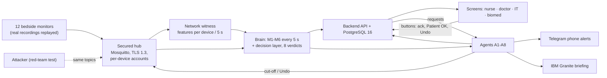

# [TessNova_IBM Z Datathon 2026 Project] SentinelWard

Team TessNova · IBM Z Datathon 2026 · Theme 1: real-time AI decisions on IBM LinuxONE.

> An ICU alarm goes off. Is it the patient, a failing sensor, or someone faking the monitor?
> SentinelWard checks a 12-bed replay every 5 seconds on IBM LinuxONE and retains available last trusted values when a monitor becomes untrusted.

**For judges:** [Judge guide (criterion → proof)](docs/submission/JUDGE-GUIDE.md) · [Flowchart](docs/flowchart/flowchart.png) · [Evidence pack](docs/evidence/INDEX.md) · [Full ward run](docs/evidence/WARD-RUN.md)

[Architecture](docs/ARCHITECTURE.md) · [Video script](docs/VIDEO-SCRIPT.md) · [Open source used](docs/OPEN-SOURCE.md) · [Read-only FHIR R4 export](docs/evidence/INTEROP.md)

## Submission

**Title:** `[TessNova_IBM Z Datathon 2026 Project]`

**Video (2:40):** https://youtu.be/JEtgz6hSekM

[Submission copy sheet](docs/submission/SUBMISSION.md) · [Judge guide](docs/submission/JUDGE-GUIDE.md)

## Explore everything yourself

Start here to inspect the screens, replay the ward and trace the results to their source. [Full setup and walkthrough](docs/EXPLORE.md).

### See every screen

All files below are in [docs/evidence/screens/](docs/evidence/screens/). As the [evidence index](docs/evidence/INDEX.md) records, **07 and 09–13 predate the redesign** (17 Oct, same data and logic, older styling); the others show the redesigned UI (18 Oct).

| Screenshot file | What it shows | Role that can open the screen |
|---|---|---|
| [01-live-ward-12-beds-mid-run.png](docs/evidence/screens/01-live-ward-12-beds-mid-run.png) | Twelve-bed ward with state bands, dark theme; captured before the cut-off-label fix, so B11 shows the obsolete flag-derived “MONITOR CUT OFF” label | Nurse, doctor, IT, operator |
| [02-live-bed-B05-tampering-six-checks.png](docs/evidence/screens/02-live-bed-B05-tampering-six-checks.png) | B05 untrusted and cut off, with the six checks | Nurse, doctor, IT, operator |
| [03-live-security-cutoffs-and-fleet-hunt.png](docs/evidence/screens/03-live-security-cutoffs-and-fleet-hunt.png) | Devices, cut-offs, incidents and fleet hunt | IT, operator |
| [04-live-action-log-agents-with-undo.png](docs/evidence/screens/04-live-action-log-agents-with-undo.png) | Agent actions and Undo | All signed-in roles; security Undo: IT/operator |
| [05-live-census-trust-column.png](docs/evidence/screens/05-live-census-trust-column.png) | Doctor's census with bed state and trust | Doctor, operator |
| [06-live-alerts-escalation-ladder.png](docs/evidence/screens/06-live-alerts-escalation-ladder.png) | Open alerts and escalation steps | Nurse, doctor, operator |
| [07-replay-bed-B03-VTACH-M2-score.png](docs/evidence/screens/07-replay-bed-B03-VTACH-M2-score.png) | B03 VTACH alarm and M2 score (older UI) | Nurse, doctor, IT, operator |
| [08-replay-bed-B06-emergency-on-cut-off-monitor.png](docs/evidence/screens/08-replay-bed-B06-emergency-on-cut-off-monitor.png) | B06 emergency on an attacked, cut-off monitor | Nurse, doctor, IT, operator |
| [09-replay-incident-timeline-sha256-evidence.png](docs/evidence/screens/09-replay-incident-timeline-sha256-evidence.png) | Incident timeline and SHA-256 evidence (older UI) | IT, operator |
| [10-replay-certin-report-draft.png](docs/evidence/screens/10-replay-certin-report-draft.png) | CERT-In report draft (older UI) | IT, operator |
| [11-live-bed-B03-VTACH-ai-chip-second-opinion.png](docs/evidence/screens/11-live-bed-B03-VTACH-ai-chip-second-opinion.png) | B03 AI-chip second opinion on nnpa:0 (older UI) | Nurse, doctor, IT, operator |
| [12-live-ward-tile-ai-chip-icon.png](docs/evidence/screens/12-live-ward-tile-ai-chip-icon.png) | AI-chip indicator on B03's ward tile (older UI) | Nurse, doctor, IT, operator |
| [13-live-bed-B03-ai-chip-empty-state.png](docs/evidence/screens/13-live-bed-B03-ai-chip-empty-state.png) | Chip panel before a result arrives (older UI) | Nurse, doctor, IT, operator |
| [14-landing-light.png](docs/evidence/screens/14-landing-light.png) | Historical landing capture before these claim corrections; current text: `web/src/pages/Landing.tsx` | Anyone, before sign-in |
| [15-sign-in-light.png](docs/evidence/screens/15-sign-in-light.png) | One-click role sign-in | Anyone, before sign-in |
| [16-ward-light.png](docs/evidence/screens/16-ward-light.png) | Ward in the light theme | Nurse, doctor, IT, operator |

### Run it yourself

- **No data download:** keep going to the existing [5-minute check](#check-it-yourself-in-5-minutes), with its recorded results and optional skips.
- **Full stack:** follow [data → packs → Docker Compose](docs/EXPLORE.md#build-the-packs-and-start-compose). It gives the LinuxONE/s390x steps we used, laptop differences, dataset sources and measured sizes. VitalDB B08–B10 must be built on a little-endian machine. The six-container copy has separate services and security limits from the full agents-on ward.
- **Open and sign in:** Compose serves `http://127.0.0.1:8001/login`; the systemd ward uses port 8000 through SSH. Click a role card; [roles and every route](docs/EXPLORE.md#open-the-ui-and-sign-in) include repair tickets, briefing and Demo, which have no screenshot here.
- **Play the ward:** `./docs/demo/sw-demo.sh run 0` starts the full 20 minutes on the systemd ward; use `PORT=8001` for local Compose. [Walkthrough and jump points](docs/EXPLORE.md#play-the-20-minute-ward) reproduce the [demo runbook](docs/DEMO-RUNBOOK.md), including why a late jump cannot reproduce B05's replay.

### Read the logs and evidence

These are checked-in files. Saved runs establish the results shown; starting your own stack is a separate check.

| What it is | Where it lives | What it proves |
|---|---|---|
| Ward runs, including night run N | [WARD-RUN.md](docs/evidence/WARD-RUN.md) | N: 12/12 beds; F1/F2/F3: 12/11/11; build differences and limits |
| N verdicts and metrics | [Timeline](docs/evidence/raw/wardrun-night/timeline_verdictsN.txt), [metrics](docs/evidence/raw/wardrun-night/metricsN.txt), [judge checks](docs/evidence/raw/wardrun-night/judgeN.txt) | Bed transitions, alerts, human steps and time-to-safe for N |
| F1 verdicts and metrics | [Timeline](docs/evidence/raw/wardrun-final/timeline_verdictsF1.txt), [metrics](docs/evidence/raw/wardrun-final/metricsF1.txt) | F1 timings and observed outcomes |
| F2 verdicts and metrics | [Timeline](docs/evidence/raw/wardrun-final/timeline_verdictsF2.txt), [metrics](docs/evidence/raw/wardrun-final/metricsF2.txt) | F2 timings, including the missing B12 detection |
| F3 verdicts and metrics | [Timeline](docs/evidence/raw/wardrun-final/timeline_verdictsF3.txt), [metrics](docs/evidence/raw/wardrun-final/metricsF3.txt) | F3 timings, including the missing B12 detection |
| Agent actions | [N agent timeline](docs/evidence/raw/wardrun-night/timeline_agentsN.txt), [containment audit](docs/evidence/raw/containment.jsonl) | A1–A8 actions, alerts, records, cut-offs and linked Undo; queued Telegram is not delivery proof |
| Systemd ward security | [15/15 raw output](docs/evidence/raw/security-live-20261017T140649Z.json), [explanation](docs/evidence/SECURITY.md) | TLS 1.3, per-device dynsec, agents/witness; own-bed ACLs, rejected access and cut-off/Undo |
| Container hub auth | [137/137 auth checks](docs/evidence/raw/containers-auth/auth.txt), [scope](docs/evidence/CONTAINERS.md) | Anonymous refused; static service accounts + topic ACLs, plaintext internal MQTT, four hardened apps, no agents/witness; authenticated replay only a 40-second spot check |
| ML held-out results and fatigue | [ML-RESULTS.md](docs/evidence/ML-RESULTS.md), [heldout2.json](ml_v2/results/heldout2.json), [fatigue.txt](docs/evidence/raw/fatigue.txt) | Locked test sets, model comparison and advice-only false/missed alarm counts |
| Robustness and model integrity | [ROBUSTNESS.md](docs/evidence/ROBUSTNESS.md), [raw results](ml_v2/results/robustness.json), [integrity tests](brain/tests/test_m2_integrity.py) | Damaged/forged inputs, hash checks and fallback, with failure cases |
| Scale and resources | [SCALE.md](docs/evidence/SCALE.md), [RESOURCES.md](docs/evidence/RESOURCES.md) | 12–96-bed short runs: median/max ticks and drops reproduced from bundled [originals](docs/evidence/raw/scale/); older extra-bed run rejected by brain |
| Containers and platform | [CONTAINERS.md](docs/evidence/CONTAINERS.md), [raw captures](docs/evidence/raw/containers/), [PLATFORM.md](docs/evidence/PLATFORM.md) | s390x build, six services, health, app hardening and container ward runs |
| FHIR sample | [Bundle JSON](docs/evidence/raw/fhir-sample-bundle.json), [INTEROP.md](docs/evidence/INTEROP.md) | Authenticated read-only R4 subset; synthetic fixture, no tested EHR connection |
| Incident SHA-256 evidence | [Incident screen](docs/evidence/screens/09-replay-incident-timeline-sha256-evidence.png), [N agent timeline](docs/evidence/raw/wardrun-night/timeline_agentsN.txt) | Saved evidence view and A3 file sizes/digests; incident payload files are not bundled here |
| CERT-In draft | [Draft screen](docs/evidence/screens/10-replay-certin-report-draft.png), [N agent timeline](docs/evidence/raw/wardrun-night/timeline_agentsN.txt) | A5 draft and clock, missing human fields; no automatic sending |
| AI-chip second opinion | [Chip live proof](chip/results/live/), [batch benchmark](chip/results/batch_bench.json) | Shown-only NNPA scoring and CPU comparison; no demonstrated speed-up |

### Map of the code

Counts repeat the existing 17 Oct fresh-clone check below, not a new run or current suite totals. A dash means that check states no count.

| Folder | What lives there | Tests / recorded passed count |
|---|---|---|
| [brain/](brain/) | Six checks, windows, model fallback and decision rules | [brain/tests/](brain/tests/): 253 + 50 skipped; 303 with packs |
| [agents_v2/](agents_v2/) | A1–A8, action engine, Telegram and Granite writer | [agents_v2/tests/](agents_v2/tests/): 121 + 1 skipped |
| [backend/](backend/) | API, WebSocket, PostgreSQL, login and FHIR | [backend/tests/](backend/tests/): 99 + 6 skipped |
| [web/](web/) | React screens, themes and role navigation | [src/](web/src/) (colocated unit tests), [e2e/](web/e2e/): 39 unit tests in 4 files in that check |
| [security_v2/](security_v2/) | Hub identities/ACLs, TLS, containment and network witness | [security_v2/tests/](security_v2/tests/): 21 |
| [simulator/](simulator/) | Bed replay, ward script, drift injection and scale mode | [simulator/tests/](simulator/tests/): 114 |
| [data/](data/) | Recording loaders, pack builder and verification | [data/tests/](data/tests/): 71, synthetic inputs |
| [ml_v2/](ml_v2/) | M2 training, artifacts, evaluation and robustness | No tests folder; [evaluation scripts](ml_v2/m2gbt/) and [results](ml_v2/results/); — |
| [chip/](chip/) | Shown-only CNN service, pinned model and NNPA benchmarks | [chip/tests/](chip/tests/); — |
| [attacks/](attacks/) | Scripted replay, flatline, drift and flood senders | [attacks/tests/](attacks/tests/): 35 |
| [common/](common/) | Shared message contract, validation, clocks and MQTT bus | [common/tests/](common/tests/): 243 + 1 skipped |
| [tests_system/](tests_system/) | Ward/resource checks, analysis and reports | [tests_system/tests/](tests_system/tests/): 32 |
| [deploy/](deploy/) | Server setup, systemd, Compose, Granite and chip install | No tests folder; [offline dry-run](deploy/README.md) and [evidence capture](deploy/containers/evidence.sh); — |
| [docs/](docs/) | Specs, architecture, demo, submission and evidence | No tests folder; [evidence index](docs/evidence/INDEX.md); — |

## Check it yourself in 5 minutes
Needs Python 3.12 and Node 22. No data download, no broker, no database. Tested from a fresh clone on a Mac (17 Oct 2026).

```bash
git clone <this repo> sentinelward && cd sentinelward
python3.12 -m venv .venv && . .venv/bin/activate
pip install -e common -e simulator -e brain -e attacks -e backend -e data -e security_v2 -e agents_v2 pytest httpx
chflags nohidden .venv/lib/python3*/site-packages/*.pth   # macOS only: lets Python see the -e installs

# Run each folder on its own (a single combined pytest run clashes on shared conftest names)
for d in common simulator brain attacks backend data security_v2 agents_v2; do python -m pytest -q $d/tests; done
python -m pytest -q tests_system

cd web && npm ci && npx vitest run && npm run build
```

Expected (measured on that fresh clone):

| Suite | Result |
|---|---|
| common | 243 passed, 1 skipped (live MQTT, needs `MQTT_TEST_HOST`) |
| simulator | 114 passed |
| brain | 253 passed, 50 skipped (M3 on real ward packs, need `SW_M3_PACKS`) |
| attacks | 35 passed |
| backend | 99 passed, 6 skipped (need `SW_TEST_PG`, a throwaway PostgreSQL) |
| data | 71 passed (synthetic records, no download) |
| security_v2 | 21 passed |
| agents_v2 | 121 passed, 1 skipped (needs `SW_AGENTS_LIVE_MOSQUITTO`) |
| tests_system | 32 passed |
| web (vitest) | 39 passed in 4 files; `npm run build` succeeds |

The 50 brain skips are optional: they run M3 on the real bed packs. With `SW_M3_PACKS=<packs-v13 folder>` set, brain gives 303 passed. Without the packs they skip; nothing fails.

Full stack with Docker (`deploy/containers/README.md`) is heavier. The simulator needs the 12 ward bed packs mounted (`SW_PACKS_DIR`), and these are not in the repo: you build them yourself from the public datasets (PhysioNet/CinC 2015, MIMIC-III Waveform sample, VitalDB) with `python -m sw_data build data/beds.yaml --out packs` (after pointing the `paths:` in `data/beds.yaml` at your downloaded copies), as described in `data/README.md` and `docs/spec/12-ward-script.md`. That means downloading the recordings, and the VitalDB beds (B08–B10) must be built on a little-endian machine. Our container runs were on LinuxONE (s390x); we did not time a from-scratch Docker run on a laptop.

## The problem
- ICU monitors raise so many false alarms that nurses learn to tune them out (alarm fatigue).
- The same monitors stream vital signs over the hospital network, where data can be replayed, forged or flooded.
- A sensor that fails or slowly drifts looks, on screen, much like a patient getting worse.
- So a central-station nurse cannot tell a real emergency from a faked or failing signal in time.

## What SentinelWard does
Bedside monitors send one reading per bed per second into a secured message hub. Every 5 seconds, six checks score every bed, a decision layer turns the six scores into one of eight verdicts with plain-word reasons, and eight agents act on that verdict (`docs/spec/00-contract-v1.2.md`, `brain/README.md`).

| Check | Question it answers |
|---|---|
| M1 | Is the sensor unusable (flat, clipped, noisy, missing)? |
| M2 | Is this monitor alarm real? (gradient-boosted trees trained on LinuxONE) |
| M3 | Do heartbeat and pulse still agree for this patient? |
| M4 | Is this a replay of the bed's own earlier data? |
| M5 | Does the device's network traffic look like an attack (flood, sequence repeats, second sender)? |
| M6 | Is the arterial line drifting away from this patient's own cuff readings? |
| D | Decision layer: one verdict, trust, up to 3 reasons, fixed precedence |

Verdicts, highest precedence first (`brain/README.md`): **BOTH** (real emergency during an attack) · **EMERGENCY** · **TAMPERING** · **DRIFTING** · **LOOSE_SENSOR** · **DEVICE_ATTACK** (IT only) · **UNSURE** (bedside hand-check) · **NORMAL**.

| Agent | Job (`agents_v2/REPORT.md`) |
|---|---|
| A1 | Alerts to screen and Telegram, one per bed episode, 30 s escalation ladder, ack |
| A2 | Marks the bed untrusted at once; cuts the device off at our own hub after 20 s of sustained evidence (at once on BOTH); Undo |
| A3 | Evidence: up to 10 minutes of buffered verdicts, scores and events at incident opening, timeline with SHA-256; no raw waveforms (`agents_v2/sw_agents/agents/a3_evidence.py`) |
| A4 | Fleet hunt for other devices of the same kind |
| A5 | CERT-In report draft with its 6-hour clock (a person sends it; no send code exists) |
| A6 | Biomed tickets for drifting / repeatedly loose sensors |
| A7 | Nurse workload (alerts per nurse in 2 h) |
| A8 | Shift briefing written by IBM Granite on LinuxONE, numeric and selected bed-status/trust checks against supplied facts (heuristic; review the prose) |

### Safety rules (enforced in code and tested)
- **Alarms are never suppressed.** The M2 score only explains an alarm; it never suppresses, delays or downgrades it (`brain/README.md`, tested in `brain/tests`).
- **Tampering never cancels an emergency.** A real alarm during an attack becomes BOTH: nurse alerted **and** device cut off (`docs/evidence/WARD-RUN.md`, B07).
- **Monitor cut-offs have an Undo**, logged as a new action that `undoes` the original (`agents_v2/REPORT.md`, `docs/evidence/SECURITY.md`).
- **Known active emergencies remain visible during containment.** The nurse is told to hand-check; the cut-off waits for 20 s of sustained evidence, or happens at once on BOTH. A disconnected monitor cannot supply later alarms; bedside monitoring is required (`docs/evidence/SECURITY.md`).
- **Retain available values.** An untrusted or cut-off bed uses its last trusted values, or flagged last values if no trusted snapshot exists. B07’s 88 legacy counts per run are a counter artefact before first data; 0 empty samples after first data in all four runs (N/F1/F2/F3). Rendered-screen continuity was not measured (`docs/evidence/WARD-RUN.md`).
- SentinelWard only listens to monitors; it never sends anything back to one. Nothing automatic touches treatment.

## The data (all open, real recordings replayed)
| Dataset | Used for |
|---|---|
| PhysioNet/CinC Challenge 2015 (false arrhythmia alarms) | M2 training/testing (all 750 training records); ward beds B03, B04, B07 |
| VTaC (5,037 labelled ventricular-tachycardia alarms) | M2 training/testing |
| MIMIC-III Waveform Matched Subset (sample) | Quiet background beds (B01, B02, B05, B06, B11, B12) |
| VitalDB (surgery recordings with arterial line + cuff) | Drift / low-pressure beds (B08, B09, B10) |

Sources: `docs/evidence/ML-RESULTS.md`, `docs/OPEN-SOURCE.md`, `docs/spec/12-ward-script.md`. The simulator replays 12 real patient recordings at 125 Hz on a scripted 20-minute ward (`docs/spec/12-ward-script.md`). This is a lab ward, not a hospital deployment.

## IBM Z / LinuxONE
Everything that decides runs natively on s390x on one IBM LinuxONE guest, the build guest: hub, six checks, decision layer, agents, backend, database, simulator, IBM Granite (`docs/evidence/PLATFORM.md`). The shown-only AI-chip second opinion runs on a second LinuxONE guest (TEST) and never changes a decision (`docs/evidence/ML-RESULTS.md`).

| Area | What we did | Evidence |
|---|---|---|
| Compute | IBM z17 (machine type 9175), CPU flag `nnpa` (Telum II on-chip AI), 3 vCPUs at 5,508 MHz, z/VM 7.3.0, Ubuntu 24.04 s390x | `docs/evidence/PLATFORM.md` |
| Telum II NNPA | Live AI-chip second opinion: a 1D-CNN on the z17 NNPA (`torch_nnpa 1.5.0`, `nnpa:0`) scores alarms it receives in time (not guaranteed for every alarm) and publishes its own probability on `ward/chip/<bed>` (N: B03 VTACH p 0.769 real, B04 ASYSTOLE p 0.166 false, B07 VFIB p 0.953 real; B06 forged ASYSTOLE received no chip score: `docs/evidence/raw/wardrun-night/chip_check.txt`). Shown only, never changes a decision; held-out 0.623 / 0.665, below the trees (0.862 / 0.832). At batch 1 it is not faster than one CPU core (median 2.11 vs 1.86 ms). Runs on the TEST LinuxONE guest in IBM's lab container, over TLS 8883 to the hub | `docs/evidence/ML-RESULTS.md` |
| AI trained on s390x | M2 trees trained on LinuxONE (scikit-learn 1.4.1), served as numpy-only trees, SHA-256 pinned | `docs/evidence/ML-RESULTS.md` |
| Containers | Six services (api, brain, sim, attacks, hub, db); app containers are non-root with read-only roots and all capabilities dropped. Container hub: authenticated static service accounts + topic ACLs, anonymous refused, **137/137 auth checks** (`docs/evidence/raw/containers-auth/auth.txt`); plaintext internal MQTT; **four** hardened app containers. Authenticated replay: **40-second spot check only**; historical full replays predate auth. Agents/witness, per-device dynsec containment and TLS 1.3 remain systemd-only | `docs/evidence/CONTAINERS.md` |
| Security | Mosquitto dynamic security, per-device accounts (each monitor may publish only its own bed), TLS 1.3 on 8883; live test 15/15 PASS; scrypt PINs, lockout, CSRF checks | `docs/evidence/SECURITY.md`, `security_v2/SECURITY.md` |
| Scale | Short 96-bed run on one brain container (1.0 CPU): median/max tick 640.44/1121.65 ms, 0 recorded drops/invalid; unchanged raw logs and recomputation bundled. Older capture rejected extra beds | `docs/evidence/SCALE.md` |
| Resources | Whole live 12-bed ward: a few percent of 3 z17 cores (brain 2.2% CPU, 268 MiB) | `docs/evidence/RESOURCES.md` |
| IBM Granite | A8's shift briefing written by IBM Granite (`granite-4.0-h-350m-base`) on LinuxONE in IBM's LinuxONE lab image; numeric and selected bed-status/trust checks against supplied facts (heuristic; review the prose), else the template is used; end-of-shift briefing written by Granite in all three final ward runs F1–F3 | `docs/evidence/WARD-RUN.md`, `agents_v2/REPORT.md` |

## Results (measured on LinuxONE, 17 Oct 2026)
**M2 "is this alarm real?"**: held-out sets locked before training (188 CinC records, 482 VTaC events); Challenge 2015 score = (TP+TN)/(TP+TN+FP+5·FN), 95% bootstrap CI (`docs/evidence/ML-RESULTS.md`).

| Model | CinC 2015 score | CinC AUROC | VTaC score | VTaC AUROC |
|---|---|---|---|---|
| Old live rule (baseline) | 0.391 [0.318, 0.484] | 0.677 | 0.336 [0.272, 0.412] | 0.505 |
| **M2 2-lead trees (live)** | **0.862 [0.785, 0.931]** | 0.968 | **0.832 [0.775, 0.885]** | 0.964 |
| 1D-CNN on z17 NNPA (live second opinion, shown only) | 0.623 | 0.881 | 0.665 | 0.883 |

**Alarm fatigue, advice only** (the monitor alarm still sounds; nothing is suppressed): at the live thresholds the 2-lead trees mark **85.1%** of false CinC 2015 held-out alarms "likely false" (97/114) and miss **2.7%** of true ones (2/74); on the VTaC test set **84.1%** (290/345) and **4.4%** (6/137). Recomputed by `ml_v2/results/fatigue.py` → `docs/evidence/raw/fatigue.txt` (per alarm type in `docs/evidence/ML-RESULTS.md`).

**Latest full ward run N (18 Oct, build `4348467`): 12/12 bed checks passed**, with B12 UNSURE at 17:04 after the witness fix. This is one post-fix run. Time-to-safe B05/B06/B07/B10: 21.2/1.2/21.3/21.2 s; 11 nurse alerts (`docs/evidence/raw/wardrun-night/metricsN.txt`, `judgeN.txt`; [cohort manifest](docs/evidence/RESULTS-MANIFEST.md)).

**Historical full 20-minute ward runs, agents on** (three back-to-back runs F1–F3 on build `f7fef1c`, 12 beds, scripted attacks, four human steps; `docs/evidence/WARD-RUN.md`):

| Measure | Result (F1 / F2 / F3) |
|---|---|
| Ward-script checks | 12/12 · 11/12 · 11/12; the one fail is B12's weak second sender, seen in 1 of 3 runs (F1 only) |
| Time-to-safe (attack start → bed untrusted + nurse told + device cut off), median of 3 | B06 3.1 s · B07 19.2 s · B05 23.2 s · B10 23.2 s |
| Real VTACH (B03) | EMERGENCY 05:04 / 05:01 / 05:02 (alarm at 05:00), ladder step 2, acked by the second nurse |
| Real VFIB during an attack (B07) | BOTH 14:04 / 14:01 / 14:02: high alert never cancelled, cut off 1 s later (14:05 / 14:02 / 14:03) |
| Replay attack (B05) | TAMPERING 09:59 / 10:01 / 10:02, cut off 10:20 / 10:22 / 10:23, IT Undo 15:29, NORMAL 16:59 / 17:06 / 17:02 |
| Quiet beds B01/B02 | 0 nurse alerts in every run |
| Nurse alerts | 11 per 20-minute run for 12 beds |
| B11 false hand-check pages | 0 / 1 / 1 |
| Telegram | 22 sent, 25–26 edited, 0 failed per run |
| IBM Granite briefing | written and accepted by numeric checks in all three historical runs; those runs do not establish current status/trust-check coverage |
| Errors | every sampled API call 200 (except `/api/briefing` 503 before the first briefing); agents bus 0 invalid, 0 dropped, 0 handler errors |

**Platform** (`docs/evidence/SECURITY.md`, `SCALE.md`, `CONTAINERS.md`): secured systemd hub: TLS 1.3, per-device dynsec, agents/witness, 15/15 PASS · container hub: authenticated static service accounts + topic ACLs, anonymous refused, 137/137 auth checks (`docs/evidence/raw/containers-auth/auth.txt`), plaintext internal MQTT, four hardened apps, no agents/witness; authenticated replay is only 40 seconds · short 96-bed scale: median/max tick 640.44/1121.65 ms, 0 recorded drops/invalid, bundled originals · historical container ward runs before auth: 0 invalid of 11,790 messages each, send lag p99 24.7 ms and 40.3 ms.

Screenshots of every step: `docs/evidence/screens/` (listed in `docs/evidence/INDEX.md`).

## Architecture
Full diagram and verdict table: `docs/ARCHITECTURE.md`.



All boxes except the monitors' sources, the phones and the screens' browsers run on the LinuxONE build guest. The shown-only AI-chip second opinion (not drawn; it never changes a decision) runs on a second LinuxONE guest and reads vitals from the hub over TLS 8883.

## How to run
- On LinuxONE as systemd services: `deploy/README.md` (`./deploy/deploy.sh --dry-run`, then `./deploy/deploy.sh`).
- As containers: `deploy/containers/README.md` (`./make-env.sh`, `docker compose build`, `docker compose up -d`).
- Hub security: `security_v2/SECURITY.md` (`setup.py`, `verify.py`, `live_test.py`, `rollback.py`).
- Agents: `agents_v2/REPORT.md`. API for the screens: `backend/API.md`.
- Start the 20-minute ward from the Demo screen (`POST /api/demo/run`); reset with `POST /api/demo/reset`.

## Repository map (written during the event)
| Folder | What |
|---|---|
| `common/` | Shared message contract (doc 00 v1.2): builders, validation, MQTT bus |
| `data/` | Bed packs built from the real recordings |
| `simulator/` | Ward simulator (12 monitors, ward script, scale mode) |
| `attacks/` | Red-team test sender (replay, fake flatline, flood, forged drift) |
| `brain/` | M1-M6 checks + decision layer, live on MQTT |
| `ml_v2/` | M2 training, held-out results, alarm-fatigue script, artifacts, NNPA CNN (live shown-only second opinion) |
| `agents_v2/` | Agents A1-A8, Telegram, IBM Granite writer |
| `security_v2/` | Hub lockdown, containment (cut-off/Undo), network witness, live security test |
| `backend/` | FastAPI + WebSocket + PostgreSQL, login hardening |
| `web/` | React screens |
| `tests_system/` | System tests (T8 ward, T10 resources) and results |
| `deploy/` | Server deploy, systemd units, containers |
| `docs/` | Architecture, specs, evidence pack, video script |

## What changed from our abstract, and why
Abstract: our Unstop submission text of 12 Oct 2026. Each row says what we built instead and where to check.

| Abstract promised | Status | What we built, and why |
|---|---|---|
| "A trained model combines six scores into one verdict" | Changed | A fixed safety precedence (BOTH > EMERGENCY > TAMPERING > … > NORMAL) with up to 3 plain reasons (`brain/README.md`). A learned fusion could quietly let an attack score outvote a real emergency; fixed rules make "tampering never cancels an emergency" provable in tests. |
| Five verdicts (emergency, sensor fault, tampering, both, unsure) | Built, extended | Eight verdicts: sensor fault split into LOOSE_SENSOR and DRIFTING; DEVICE_ATTACK (IT only) and NORMAL added (`brain/README.md`). |
| Two witnesses: body (M3, M4, M6) and network ("is the right device sending?") | Built, limited provenance | Build `4348467` fixes sender-window expiry: N caught B12 at 17:04 with multiple publishers observed (`docs/evidence/raw/wardrun-night/timeline_verdictsN.txt`, `judgeN.txt`). Counts are distinct broker client IDs per bed topic, not cryptographic identity of each frame (`security_v2/sw_sec/features.py`, `brain/sw_brain/detectors.py`). F1–F3 had unavailable counts and caught B12 only in F1; N is one post-fix run. |
| IBM Snap ML, XGBoost and PyTorch for the alarm, replay and drift models | Changed | M2 is scikit-learn 1.4.1 gradient-boosted trees trained on s390x, served as hash-pinned numpy trees (`ml_v2/README.md`). Replay (M4) and drift (M6) are explainable rules, not trained models (`brain/README.md`). PyTorch is used only for the NNPA CNN second opinion (`chip/README.md`). Neither Snap ML nor XGBoost is in the build. |
| NeuroKit2 for ECG signal quality | Changed | M1 is our own numpy check (flat, clipped, noisy, missing; `brain/README.md`). |
| Nine open datasets (VTaC, CinC 2015 and 2011, SecAlarmBench, MIT-BIH NST, VitalDB, CICIoMT2024, WUSTL-EHMS-2020, MIMIC-III) | Changed: 4 used | PhysioNet/CinC 2015, VTaC, MIMIC-III Waveform Matched Subset, VitalDB (`docs/OPEN-SOURCE.md`). CinC 2011, SecAlarmBench, MIT-BIH NST, CICIoMT2024 and WUSTL-EHMS-2020 are not used: we test the network checks against our own scripted attacks on the live hub (`attacks/`). |
| Split by patient | Changed | Split by record: CinC 2015 has no patient IDs, so record = group; the held-out set was locked before training (`docs/evidence/ML-RESULTS.md`). |
| LangGraph agents with a human approval step | Changed | Our own small engine: every action goes through one allow-list, is validated and logged append-only, with Undo for supported reversible actions (`agents_v2/REPORT.md`, `agents_v2/sw_agents/engine.py`). The CERT-In report is only drafted; a person sends it (no send code). The device cut-off is automatic (20 s of evidence, at once on BOTH), limited to our own hub and undoable, not pre-approved. |
| IBM Granite 1B and 2B write alerts and shift briefings | Changed | IBM Granite `granite-4.0-h-350m-base` from IBM's LinuxONE lab image writes the shift briefing only, and numeric plus selected bed-status/trust checks reject detected mismatches to a template; the checks are heuristic and prose needs review (`agents_v2/REPORT.md`). Nurse alerts use fixed wording (`agents_v2/sw_agents/agents/a1_alerts.py`), so a model cannot change what an alert says. |
| Scapy for our attack scripts | Changed | The red-team sender publishes over MQTT with our shared message code (`attacks/`); no Scapy. |
| Patient data stays on one secure server | Built, one addition | Every decision runs on the build guest. The shown-only AI-chip second opinion reads vitals over TLS 8883 on a second LinuxONE guest (`docs/evidence/ML-RESULTS.md`). |
| Measure missed emergencies, false alarms cut, time to safe, Blind Time | Built, changed | Missed / false alarms on held-out data (`docs/evidence/raw/fatigue.txt`), as advice only, because alarms are never suppressed. Time-to-safe in every final ward run (`docs/evidence/WARD-RUN.md`). Blind Time: defined in the system tests (`tests_system/README.md`, `tests_system/metrics.py`) but no measured Blind Time figure is in the evidence pack, so we make no Blind Time claim. |
| Pre-event tests: Snap ML 6.0 s vs scikit-learn 25.1 s; hub carried 2,000 beds | Not in this repo | Those were pre-event checks and are not re-measured here. The short-run originals reproduce 96 beds per brain container (median/max tick 640.44/1121.65 ms, 0 recorded drops/invalid) (`docs/evidence/SCALE.md`). |
| Safety rules, 8 agents, cut-off at our hub, last trusted values kept, tamper-evident evidence, Telegram, FastAPI, PostgreSQL, React | Built as promised | `docs/evidence/SECURITY.md`, `agents_v2/REPORT.md`, `docs/evidence/WARD-RUN.md`. |

## Honest limits
- Lab ward with replayed recordings, not a clinical device; not approved for clinical use.
- Confidence and trust are uncalibrated heuristic numbers (`brain/README.md`).
- M2's alarm-fatigue numbers are advice only: the monitor alarm still sounds, so they show how many alarms a nurse could deprioritise, not alarms removed (`docs/evidence/raw/fatigue.txt`).
- M2: small per-type held-out sets (VFIB has 1 true alarm), wide intervals; thresholds tuned for the Challenge's 5× cost on missed alarms, so specificity is modest; not directly comparable with the 2015 winners' hidden test set (`docs/evidence/ML-RESULTS.md`).
- Latest N on build `4348467`: B12 caught at 17:04 after the witness fix (one post-fix run). Historical F1–F3: B12's weak second-sender attack surfaced in 1 of 3 runs (F1). Those historical runs had no usable per-sender count (`sender_identity_available: False` in all three), leaving detection dependent on duplicate-copy timing; N now has window-level client counts, without per-frame identity. B05 returned to NORMAL at 16:59–17:06 after the 15:29 Undo (the tampering latch waits for clean data). B11 had 0 / 1 / 1 UNSURE hand-check pages, which closed on their own (`docs/evidence/WARD-RUN.md`).
- Because alarms are never suppressed, B04's false asystole and B06's faked flatline show EMERGENCY / BOTH while their alarm is held, not the LOOSE_SENSOR / TAMPERING the script expected (`brain/README.md`).
- Scale: 96 beds was the largest recorded test, short 3-minute runs; unchanged tick logs are bundled with hashes and a recomputation script; a 96-bed soak was not run (`docs/evidence/SCALE.md`).
- Security: a valid stolen device password can still forge its own bed; the demo attack account is exempt from cut-off; all services share one Unix user; no packet-level capture (`security_v2/SECURITY.md`).
- Granite checks numbers and selected bed-status/trust claims against supplied facts. These checks are heuristic, not proof of semantic accuracy: the judge reproduced unsupported status prose. Review the text against structured incident facts; prose is advisory (`agents_v2/sw_agents/granite.py`).
- The agents run as a systemd service, not yet as a container (`docs/evidence/CONTAINERS.md`, `docs/evidence/RESOURCES.md`).

## Team TessNova
- **Aditya Singh** (lead): integration, LinuxONE server, hub, simulator, data, backend + database, deploy, system tests.
- **Aditya Singhal**: M2 models (`ml_v2/`) and the brain's decision pipeline.
- **Aditya**: agents A1-A8 (`agents_v2/`).
- **Kartik**: hub security, M5 network witness and device cut-off (`security_v2/`).
- **Antara Gupta**: React screens (`web/`).

Built during the event with AI coding assistants (Claude Code, Codex, Kiro).

## Sources / open-source

SentinelWard uses third-party software, models and datasets. Component uses and
version-manifest locations are documented in [docs/OPEN-SOURCE.md](docs/OPEN-SOURCE.md);
server and web dependencies are recorded in `deploy/requirements-server.txt`, the
Python packages' `pyproject.toml` files, and `web/package.json` / `web/package-lock.json`.
These upstream works are credited separately from the team's application code.
The team's own code is released under the [MIT License](LICENSE); third-party works keep their own licences.

- **Data:** [PhysioNet/CinC Challenge 2015](https://physionet.org/content/challenge-2015/1.0.0/)
  and [VTaC](https://physionet.org/content/vtac/1.0/) for M2 alarm training/evaluation;
  [MIMIC-III Waveform Database Matched Subset](https://physionet.org/content/mimic3wdb-matched/1.0/)
  for background ward recordings; [VitalDB](https://vitaldb.net/) for arterial-line/cuff recordings.
- **Platform and model:** [Ubuntu s390x](https://ubuntu.com/download/server/s390x),
  [Eclipse Mosquitto](https://mosquitto.org/) (EPL-2.0 / EDL-1.0), [PostgreSQL](https://www.postgresql.org/) (PostgreSQL License),
  [Docker](https://www.docker.com/) and [Compose](https://docs.docker.com/compose/) (Apache-2.0),
  [OpenSSL](https://www.openssl.org/) (Apache-2.0), and [systemd](https://systemd.io/) (LGPL-2.1+).
  Shift briefings use [IBM Granite](https://github.com/ibm-granite) (Apache-2.0 weights) through
  [llama.cpp](https://github.com/ggml-org/llama.cpp) /
  [llama-cpp-python](https://github.com/abetlen/llama-cpp-python) (MIT) in
  [IBM's LinuxONE lab image](https://github.com/linuxone-community-cloud/jupyter-lab-ml).
  The AI-chip second opinion (a 1D-CNN run live on the z17 NNPA, shown only, never used in decisions) uses
  [PyTorch](https://pytorch.org/) (BSD-3-Clause) with IBM's `torch_nnpa` from the same lab image.
- **Python libraries:** [NumPy](https://numpy.org/), [SciPy](https://scipy.org/),
  [scikit-learn](https://scikit-learn.org/) (all BSD-3-Clause),
  [WFDB](https://github.com/MIT-LCP/wfdb-python) (MIT), [vitaldb](https://github.com/vitaldb/vitaldb-python),
  [FastAPI](https://fastapi.tiangolo.com/) and [Pydantic](https://docs.pydantic.dev/) (MIT),
  [Uvicorn](https://www.uvicorn.org/) and [websockets](https://websockets.readthedocs.io/) (BSD-3-Clause),
  [Paho MQTT](https://github.com/eclipse-paho/paho.mqtt.python) (EPL-2.0 / EDL-1.0),
  [psycopg](https://www.psycopg.org/) (LGPL-3.0), [HTTPX](https://www.python-httpx.org/) (BSD-3-Clause),
  [PyYAML](https://pyyaml.org/) and [pytest](https://pytest.org/) (MIT).
- **Web libraries and tools:** [React](https://react.dev/), [React Router](https://reactrouter.com/),
  [Vite](https://vite.dev/), [Zustand](https://github.com/pmndrs/zustand), [uPlot](https://github.com/leeoniya/uPlot),
  [jsPDF](https://github.com/parallax/jsPDF), [Vitest](https://vitest.dev/) (all MIT),
  [TypeScript](https://www.typescriptlang.org/) (Apache-2.0), [Lucide](https://lucide.dev/) (ISC),
  [IBM Plex fonts via Fontsource](https://fontsource.org/fonts/ibm-plex-sans) (OFL-1.1),
  [Testing Library](https://testing-library.com/), [jsdom](https://github.com/jsdom/jsdom) (MIT),
  [Playwright](https://playwright.dev/) (Apache-2.0) and [axe-core](https://github.com/dequelabs/axe-core) (MPL-2.0).

Demo phone alerts use the [Telegram Bot API](https://core.telegram.org/bots/api).
Dataset access and reuse remain subject to each provider's terms; this credit list
makes no claim that upstream software, model weights or recordings are team-authored.
