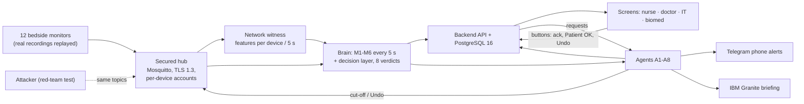

# [TessNova_IBM Z Datathon 2026 Project] SentinelWard

Team TessNova · IBM Z Datathon 2026 · Theme 1: real-time AI decisions on IBM LinuxONE.

> An ICU alarm goes off. Is it the patient, a failing sensor, or someone faking the monitor?
> SentinelWard answers for every bed, every 5 seconds, on IBM LinuxONE, and never shows a patient blank.

**For judges:** [Judge guide (criterion → proof)](docs/submission/JUDGE-GUIDE.md) · [Flowchart](docs/flowchart/flowchart.png) · [Evidence pack](docs/evidence/INDEX.md) · [Full ward run](docs/evidence/WARD-RUN.md)

[Architecture](docs/ARCHITECTURE.md) · [Video script](docs/VIDEO-SCRIPT.md) · [Open source used](docs/OPEN-SOURCE.md) · [Read-only FHIR R4 export](docs/evidence/INTEROP.md)

## Check it yourself in 5 minutes
Needs Python 3.12 and Node 22. No data download, no broker, no database. Tested from a fresh clone on a Mac (17 Oct 2026).

```bash
git clone <this repo> sentinelward && cd sentinelward
python3.12 -m venv .venv && . .venv/bin/activate
pip install -e common -e simulator -e brain -e attacks -e backend -e data -e security_v2 -e agents_v2 pytest httpx
chflags nohidden .venv/lib/python3*/site-packages/*.pth   # macOS only: lets Python see the -e installs

# Run each folder on its own (a single combined pytest run clashes on shared conftest names)
for d in common simulator brain attacks backend data security_v2 agents_v2; do python -m pytest -q $d/tests; done
python -m pytest -q tests_system

cd web && npm ci && npx vitest run && npm run build
```

Expected (measured on that fresh clone):

| Suite | Result |
|---|---|
| common | 243 passed, 1 skipped (live MQTT, needs `MQTT_TEST_HOST`) |
| simulator | 114 passed |
| brain | 253 passed, 50 skipped (M3 on real ward packs, need `SW_M3_PACKS`) |
| attacks | 35 passed |
| backend | 99 passed, 6 skipped (need `SW_TEST_PG`, a throwaway PostgreSQL) |
| data | 71 passed (synthetic records, no download) |
| security_v2 | 21 passed |
| agents_v2 | 121 passed, 1 skipped (needs `SW_AGENTS_LIVE_MOSQUITTO`) |
| tests_system | 32 passed |
| web (vitest) | 39 passed in 4 files; `npm run build` succeeds |

The 50 brain skips are optional: they run M3 on the real bed packs. With `SW_M3_PACKS=<packs-v13 folder>` set, brain gives 303 passed. Without the packs they skip; nothing fails.

Full stack with Docker (`deploy/containers/README.md`) is heavier. The simulator needs the 12 ward bed packs mounted (`SW_PACKS_DIR`), and these are not in the repo: you build them yourself from the public datasets (PhysioNet/CinC 2015, MIMIC-III Waveform sample, VitalDB) with `python -m sw_data build data/beds.yaml --out packs` (after pointing the `paths:` in `data/beds.yaml` at your downloaded copies), as described in `data/README.md` and `docs/spec/12-ward-script.md`. That means downloading the recordings, and the VitalDB beds (B08–B10) must be built on a little-endian machine. Our container runs were on LinuxONE (s390x); we did not time a from-scratch Docker run on a laptop.

## The problem
- ICU monitors raise so many false alarms that nurses learn to tune them out (alarm fatigue).
- The same monitors stream vital signs over the hospital network, where data can be replayed, forged or flooded.
- A sensor that fails or slowly drifts looks, on screen, much like a patient getting worse.
- So a central-station nurse cannot tell a real emergency from a faked or failing signal in time.

## What SentinelWard does
Bedside monitors send one reading per bed per second into a secured message hub. Every 5 seconds, six checks score every bed, a decision layer turns the six scores into one of eight verdicts with plain-word reasons, and eight agents act on that verdict (`docs/spec/00-contract-v1.2.md`, `brain/README.md`).

| Check | Question it answers |
|---|---|
| M1 | Is the sensor unusable (flat, clipped, noisy, missing)? |
| M2 | Is this monitor alarm real? (gradient-boosted trees trained on LinuxONE) |
| M3 | Do heartbeat and pulse still agree for this patient? |
| M4 | Is this a replay of the bed's own earlier data? |
| M5 | Does the device's network traffic look like an attack (flood, sequence repeats, second sender)? |
| M6 | Is the arterial line drifting away from this patient's own cuff readings? |
| D | Decision layer: one verdict, trust, up to 3 reasons, fixed precedence |

Verdicts, highest precedence first (`brain/README.md`): **BOTH** (real emergency during an attack) · **EMERGENCY** · **TAMPERING** · **DRIFTING** · **LOOSE_SENSOR** · **DEVICE_ATTACK** (IT only) · **UNSURE** (bedside hand-check) · **NORMAL**.

| Agent | Job (`agents_v2/REPORT.md`) |
|---|---|
| A1 | Alerts to screen and Telegram, one per bed episode, 30 s escalation ladder, ack |
| A2 | Marks the bed untrusted at once; cuts the device off at our own hub after 20 s of sustained evidence (at once on BOTH); Undo |
| A3 | Evidence: 10-minute ring buffer per bed, timeline with SHA-256 |
| A4 | Fleet hunt for other devices of the same kind |
| A5 | CERT-In report draft with its 6-hour clock (a person sends it; no send code exists) |
| A6 | Biomed tickets for drifting / repeatedly loose sensors |
| A7 | Nurse workload (alerts per nurse in 2 h) |
| A8 | Shift briefing written by IBM Granite on LinuxONE, every number fact-checked |

### Safety rules (enforced in code and tested)
- **Alarms are never suppressed.** The M2 score only explains an alarm; it never suppresses, delays or downgrades it (`brain/README.md`, tested in `brain/tests`).
- **Tampering never cancels an emergency.** A real alarm during an attack becomes BOTH: nurse alerted **and** device cut off (`docs/evidence/WARD-RUN.md`, B07).
- **Every automatic action has an Undo**, logged as a new action that `undoes` the original (`agents_v2/REPORT.md`, `docs/evidence/SECURITY.md`).
- **A cut-off never hides a real alarm.** The nurse is told to hand-check at once; the cut-off waits for 20 s of sustained evidence, or happens at once when an emergency is also present (`docs/evidence/SECURITY.md`).
- **The patient is never blank.** An untrusted or cut-off bed keeps showing its last trusted values (`docs/evidence/WARD-RUN.md`).
- SentinelWard only listens to monitors; it never sends anything back to one. Nothing automatic touches treatment.

## The data (all open, real recordings replayed)
| Dataset | Used for |
|---|---|
| PhysioNet/CinC Challenge 2015 (false arrhythmia alarms) | M2 training/testing (all 750 training records); ward beds B03, B04, B07 |
| VTaC (5,037 labelled ventricular-tachycardia alarms) | M2 training/testing |
| MIMIC-III Waveform Matched Subset (sample) | Quiet background beds (B01, B02, B05, B06, B11, B12) |
| VitalDB (surgery recordings with arterial line + cuff) | Drift / low-pressure beds (B08, B09, B10) |

Sources: `docs/evidence/ML-RESULTS.md`, `docs/OPEN-SOURCE.md`, `docs/spec/12-ward-script.md`. The simulator replays 12 real patient recordings at 125 Hz on a scripted 20-minute ward (`docs/spec/12-ward-script.md`). This is a lab ward, not a hospital deployment.

## IBM Z / LinuxONE
Everything that decides runs natively on s390x on one IBM LinuxONE guest: hub, six checks, decision layer, agents, backend, database, simulator, IBM Granite (`docs/evidence/PLATFORM.md`).

| Area | What we did | Evidence |
|---|---|---|
| Compute | IBM z17 (machine type 9175), CPU flag `nnpa` (Telum II on-chip AI), 3 vCPUs at 5,508 MHz, z/VM 7.3.0, Ubuntu 24.04 s390x | `docs/evidence/PLATFORM.md` |
| Telum II NNPA | Live AI-chip second opinion: a 1D-CNN on the z17 NNPA (`torch_nnpa 1.5.0`, `nnpa:0`) scores every alarm the brain scores with M2 and publishes its own probability on `ward/chip/<bed>` (live run: B03 VTACH p 0.769 real, B04 ASYSTOLE p 0.166 false, B07 VFIB p 0.953 real). Shown only, never changes a decision; held-out 0.623 / 0.665, below the trees (0.862 / 0.832). At batch 1 it is not faster than one CPU core (median 2.11 vs 1.86 ms). Runs on the TEST LinuxONE guest in IBM's lab container, over TLS 8883 to the hub | `docs/evidence/ML-RESULTS.md` |
| AI trained on s390x | M2 trees trained on LinuxONE (scikit-learn 1.4.1), served as numpy-only trees, SHA-256 pinned | `docs/evidence/ML-RESULTS.md` |
| Containers | One s390x image built on LinuxONE; 6 containers (api, brain, sim, attacks, hub, db); non-root, read-only root, all capabilities dropped, no compiler in the image; two 20-minute ward runs inside: 11,790 messages each, 0 invalid | `docs/evidence/CONTAINERS.md` |
| Security | Mosquitto dynamic security, per-device accounts (each monitor may publish only its own bed), TLS 1.3 on 8883; live test 15/15 PASS; scrypt PINs, lockout, CSRF checks | `docs/evidence/SECURITY.md`, `security_v2/SECURITY.md` |
| Scale | One brain container (1.0 CPU) kept up with 96 beds: slowest tick 1.12 s of its 5 s budget (22.4%), 0 dropped | `docs/evidence/SCALE.md` |
| Resources | Whole live 12-bed ward: a few percent of 3 z17 cores (brain 2.2% CPU, 268 MiB) | `docs/evidence/RESOURCES.md` |
| IBM Granite | A8's shift briefing written by IBM Granite on LinuxONE in IBM's LinuxONE lab image; fact-checked, template fallback not needed in ward run 3 | `docs/evidence/WARD-RUN.md`, `agents_v2/REPORT.md` |

## Results (measured on LinuxONE, 17 Oct 2026)
**M2 "is this alarm real?"**: held-out sets locked before training (188 CinC records, 482 VTaC events); Challenge 2015 score = (TP+TN)/(TP+TN+FP+5·FN), 95% bootstrap CI (`docs/evidence/ML-RESULTS.md`).

| Model | CinC 2015 score | CinC AUROC | VTaC score | VTaC AUROC |
|---|---|---|---|---|
| Old live rule (baseline) | 0.391 [0.318, 0.484] | 0.677 | 0.336 [0.272, 0.412] | 0.505 |
| **M2 2-lead trees (live)** | **0.862 [0.785, 0.931]** | 0.968 | **0.832 [0.775, 0.885]** | 0.964 |
| 1D-CNN on z17 NNPA (live second opinion, shown only) | 0.623 | 0.881 | 0.665 | 0.883 |

**Full 20-minute ward run, agents on** (run `run_20261017_141851`, 12 beds, scripted attacks; `docs/evidence/WARD-RUN.md`):

| Measure | Result |
|---|---|
| Ward-script checks | 12 of 13 PASS; B12 weak attack NOT SHOWN (cause found and fixed) |
| Event → verdict | +2 s to +3 s for every scripted event (B03, B04, B05, B06, B07, B08, B10, B11) |
| Time-to-safe (attack start → bed untrusted + nurse told + device cut off) | B06 4.3 s · B07 19.3 s · B05 24.2 s · B10 29.3 s |
| Real VTACH (B03) | EMERGENCY +2 s, ladder step 2 at 30 s, acked 05:48 |
| Real VFIB during an attack (B07) | BOTH 14:02: high alert never cancelled, cut off 14:03 |
| Replay attack (B05) | TAMPERING 10:02, cut off 10:23, IT Undo 15:29, NORMAL 17:02 |
| Quiet beds B01/B02 | 0 nurse alerts |
| Nurse alerts | 13 in 20 minutes for 12 beds |
| Telegram | 24 sent + 27 edited, 0 failed |
| Errors | 0 API errors, 0 agent errors; no bed lost its values |

**Platform** (`docs/evidence/SECURITY.md`, `SCALE.md`, `CONTAINERS.md`): security live test 15/15 PASS · 96 beds per brain container at 22.4% of the tick · container ward runs 0 invalid of 11,790 messages, send lag p99 24.7 ms and 40.3 ms.

Screenshots of every step: `docs/evidence/screens/` (listed in `docs/evidence/INDEX.md`).

## Architecture
Full diagram and verdict table: `docs/ARCHITECTURE.md`.



All boxes except the monitors' sources, the phones and the screens' browsers run on the LinuxONE guest.

## How to run
- On LinuxONE as systemd services: `deploy/README.md` (`./deploy/deploy.sh --dry-run`, then `./deploy/deploy.sh`).
- As containers: `deploy/containers/README.md` (`./make-env.sh`, `docker compose build`, `docker compose up -d`).
- Hub security: `security_v2/SECURITY.md` (`setup.py`, `verify.py`, `live_test.py`, `rollback.py`).
- Agents: `agents_v2/REPORT.md`. API for the screens: `backend/API.md`.
- Start the 20-minute ward from the Demo screen (`POST /api/demo/run`); reset with `POST /api/demo/reset`.

## Repository map (written during the event)
| Folder | What |
|---|---|
| `common/` | Shared message contract (doc 00 v1.2): builders, validation, MQTT bus |
| `data/` | Bed packs built from the real recordings |
| `simulator/` | Ward simulator (12 monitors, ward script, scale mode) |
| `attacks/` | Red-team test sender (replay, fake flatline, flood, forged drift) |
| `brain/` | M1-M6 checks + decision layer, live on MQTT |
| `ml_v2/` | M2 training, held-out results, artifacts, NNPA CNN experiment |
| `agents_v2/` | Agents A1-A8, Telegram, IBM Granite writer |
| `security_v2/` | Hub lockdown, containment (cut-off/Undo), network witness, live security test |
| `backend/` | FastAPI + WebSocket + PostgreSQL, login hardening |
| `web/` | React screens |
| `tests_system/` | System tests (T8 ward, T10 resources) and results |
| `deploy/` | Server deploy, systemd units, containers |
| `docs/` | Architecture, specs, evidence pack, video script |

## Honest limits
- Lab ward with replayed recordings, not a clinical device; not approved for clinical use.
- Confidence and trust are uncalibrated heuristic numbers (`brain/README.md`).
- M2: small per-type held-out sets (VFIB has 1 true alarm), wide intervals; thresholds tuned for the Challenge's 5× cost on missed alarms, so specificity is modest; not directly comparable with the 2015 winners' hidden test set (`docs/evidence/ML-RESULTS.md`).
- Ward run 3: B12's weak second-sender attack did not surface (the network witness could not read the hub log; fixed, re-run pending); B05 took 92 s to return to NORMAL after Undo; B11 had 3 UNSURE hand-check pages from a clipped pulse (`docs/evidence/WARD-RUN.md`).
- Because alarms are never suppressed, B04's false asystole and B06's faked flatline show EMERGENCY / BOTH while their alarm is held, not the LOOSE_SENSOR / TAMPERING the script expected (`brain/README.md`).
- Scale: 96 beds was the largest test, 3-minute runs; a 96-bed soak was not run (`docs/evidence/SCALE.md`).
- Security: a valid stolen device password can still forge its own bed; the demo attack account is exempt from cut-off; all services share one Unix user; no packet-level capture (`security_v2/SECURITY.md`).
- The agents run as a systemd service, not yet as a container (`docs/evidence/CONTAINERS.md`, `docs/evidence/RESOURCES.md`).

## Team TessNova
- **Aditya Singh** (lead): integration, LinuxONE server, hub, simulator, data, backend + database, deploy, system tests.
- **Aditya Singhal**: M2 models (`ml_v2/`) and the brain's decision pipeline.
- **Aditya**: agents A1-A8 (`agents_v2/`).
- **Kartik**: hub security, M5 network witness and device cut-off (`security_v2/`).
- **Antara Gupta**: React screens (`web/`).

Built during the event with AI coding assistants (Claude Code, Codex, Kiro).

## Sources / open-source

SentinelWard uses third-party software, models and datasets. Component uses and
version-manifest locations are documented in [docs/OPEN-SOURCE.md](docs/OPEN-SOURCE.md);
server and web dependencies are recorded in `deploy/requirements-server.txt`, the
Python packages' `pyproject.toml` files, and `web/package.json` / `web/package-lock.json`.
These upstream works are credited separately from the team's application code.

- **Data:** [PhysioNet/CinC Challenge 2015](https://physionet.org/content/challenge-2015/1.0.0/)
  and [VTaC](https://physionet.org/content/vtac/1.0/) for M2 alarm training/evaluation;
  [MIMIC-III Waveform Database Matched Subset](https://physionet.org/content/mimic3wdb-matched/1.0/)
  for background ward recordings; [VitalDB](https://vitaldb.net/) for arterial-line/cuff recordings.
- **Platform and model:** [Ubuntu s390x](https://ubuntu.com/download/server/s390x),
  [Eclipse Mosquitto](https://mosquitto.org/) (EPL-2.0 / EDL-1.0), [PostgreSQL](https://www.postgresql.org/) (PostgreSQL License),
  [Docker](https://www.docker.com/) and [Compose](https://docs.docker.com/compose/) (Apache-2.0),
  [OpenSSL](https://www.openssl.org/) (Apache-2.0), and [systemd](https://systemd.io/) (LGPL-2.1+).
  Shift briefings use [IBM Granite](https://github.com/ibm-granite) (Apache-2.0 weights) through
  [llama.cpp](https://github.com/ggml-org/llama.cpp) /
  [llama-cpp-python](https://github.com/abetlen/llama-cpp-python) (MIT) in
  [IBM's LinuxONE lab image](https://github.com/linuxone-community-cloud/jupyter-lab-ml).
  The AI-chip second opinion (a 1D-CNN run live on the z17 NNPA, shown only, never used in decisions) uses
  [PyTorch](https://pytorch.org/) (BSD-3-Clause) with IBM's `torch_nnpa` from the same lab image.
- **Python libraries:** [NumPy](https://numpy.org/), [SciPy](https://scipy.org/),
  [scikit-learn](https://scikit-learn.org/) (all BSD-3-Clause),
  [WFDB](https://github.com/MIT-LCP/wfdb-python) (MIT), [vitaldb](https://github.com/vitaldb/vitaldb-python),
  [FastAPI](https://fastapi.tiangolo.com/) and [Pydantic](https://docs.pydantic.dev/) (MIT),
  [Uvicorn](https://www.uvicorn.org/) and [websockets](https://websockets.readthedocs.io/) (BSD-3-Clause),
  [Paho MQTT](https://github.com/eclipse-paho/paho.mqtt.python) (EPL-2.0 / EDL-1.0),
  [psycopg](https://www.psycopg.org/) (LGPL-3.0), [HTTPX](https://www.python-httpx.org/) (BSD-3-Clause),
  [PyYAML](https://pyyaml.org/) and [pytest](https://pytest.org/) (MIT).
- **Web libraries and tools:** [React](https://react.dev/), [React Router](https://reactrouter.com/),
  [Vite](https://vite.dev/), [Zustand](https://github.com/pmndrs/zustand), [uPlot](https://github.com/leeoniya/uPlot),
  [jsPDF](https://github.com/parallax/jsPDF), [Vitest](https://vitest.dev/) (all MIT),
  [TypeScript](https://www.typescriptlang.org/) (Apache-2.0), [Lucide](https://lucide.dev/) (ISC),
  [IBM Plex fonts via Fontsource](https://fontsource.org/fonts/ibm-plex-sans) (OFL-1.1),
  [Testing Library](https://testing-library.com/), [jsdom](https://github.com/jsdom/jsdom) (MIT),
  [Playwright](https://playwright.dev/) (Apache-2.0) and [axe-core](https://github.com/dequelabs/axe-core) (MPL-2.0).

Demo phone alerts use the [Telegram Bot API](https://core.telegram.org/bots/api).
Dataset access and reuse remain subject to each provider's terms; this credit list
makes no claim that upstream software, model weights or recordings are team-authored.
