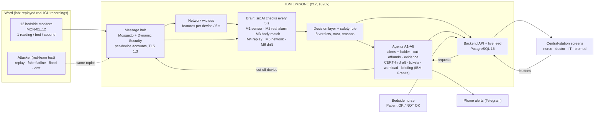

# SentinelWard architecture

Everything inside the IBM LinuxONE box runs on one IBM LinuxONE guest (IBM z17, s390x; `docs/evidence/PLATFORM.md`).

## The five safety rules (every part obeys them)
1. A patient is never shown blank (last trusted values stay, marked untrusted).
2. Suspected tampering never cancels an emergency (verdict BOTH = alert **and** cut-off).
3. Every automatic action is logged and can be undone with one click.
4. Nothing automatic touches treatment.
5. Official reports are drafted by an agent and sent by a person.

## Verdicts (precedence BOTH > EMERGENCY > TAMPERING > DRIFTING > LOOSE_SENSOR > DEVICE_ATTACK > UNSURE > NORMAL; `brain/README.md`)
| Verdict | Priority | Who hears |
|---|---|---|
| NORMAL | none | nobody |
| EMERGENCY | high | nurse now, escalation ladder |
| BOTH | high | nurse now **and** device cut off at once |
| TAMPERING | medium | bed untrusted + bedside hand-check at once; IT; device cut off after 20 s of sustained evidence |
| UNSURE | medium | bedside hand-check |
| DRIFTING | medium | bedside nurse + biomed ticket |
| LOOSE_SENSOR | low | bedside nurse: refit the sensor (the monitor alarm itself is never suppressed) |
| DEVICE_ATTACK | none for nurses | IT only |
