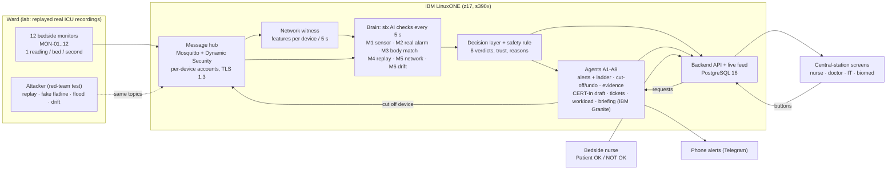

# SentinelWard architecture

Everything that decides runs on one IBM LinuxONE guest, the build guest (IBM z17, s390x; `docs/evidence/PLATFORM.md`). The shown-only AI-chip second opinion (1D-CNN on the Telum II NNPA) runs on a second LinuxONE guest and never changes a decision (`docs/evidence/ML-RESULTS.md`).

The witness counts distinct broker client IDs per bed topic in 5-second windows, not cryptographic identity of each frame (`security_v2/sw_sec/features.py`). Build `4348467` fixes window expiry; N caught B12 at 17:04 after historical misses (`docs/evidence/WARD-RUN.md`).

The secured systemd ward and six-container Compose stack are separate configurations. Compose uses authenticated static service accounts + topic ACLs, anonymous refused (137/137 checks, `docs/evidence/raw/containers-auth/auth.txt`), plaintext internal MQTT, four hardened app containers and no agents/witness. The authenticated replay is a 40-second spot check only; the systemd ward uses TLS 1.3, per-device dynsec, agents and the witness (15/15 security checks) (`docs/EXPLORE.md`).

## Safety behavior and limits
1. Keep available last trusted values marked untrusted, or flagged last values if no trusted pin exists. B07’s 88 legacy counts per run are a counter artefact before first data; 0 empty samples after first data in all four runs (N/F1/F2/F3). Rendered-screen continuity was not measured (`docs/evidence/WARD-RUN.md`).
2. Suspected tampering never cancels an emergency (verdict BOTH = alert **and** cut-off).
3. Actions are logged; monitor cut-offs and supported reversible actions have Undo. Notifications and evidence records cannot be unsent or erased by Undo.
4. Nothing automatic touches treatment.
5. Official reports are drafted by an agent and sent by a person.

## Verdicts (precedence BOTH > EMERGENCY > TAMPERING > DRIFTING > LOOSE_SENSOR > DEVICE_ATTACK > UNSURE > NORMAL; `brain/README.md`)
| Verdict | Priority | Who hears |
|---|---|---|
| NORMAL | none | nobody |
| EMERGENCY | high | nurse now, escalation ladder |
| BOTH | high | nurse now **and** device cut off at once |
| TAMPERING | medium | bed untrusted + bedside hand-check at once; IT; device cut off after 20 s of sustained evidence |
| UNSURE | medium | bedside hand-check |
| DRIFTING | medium | bedside nurse + biomed ticket |
| LOOSE_SENSOR | low | bedside nurse: refit the sensor (the monitor alarm itself is never suppressed) |
| DEVICE_ATTACK | none for nurses | IT only |
